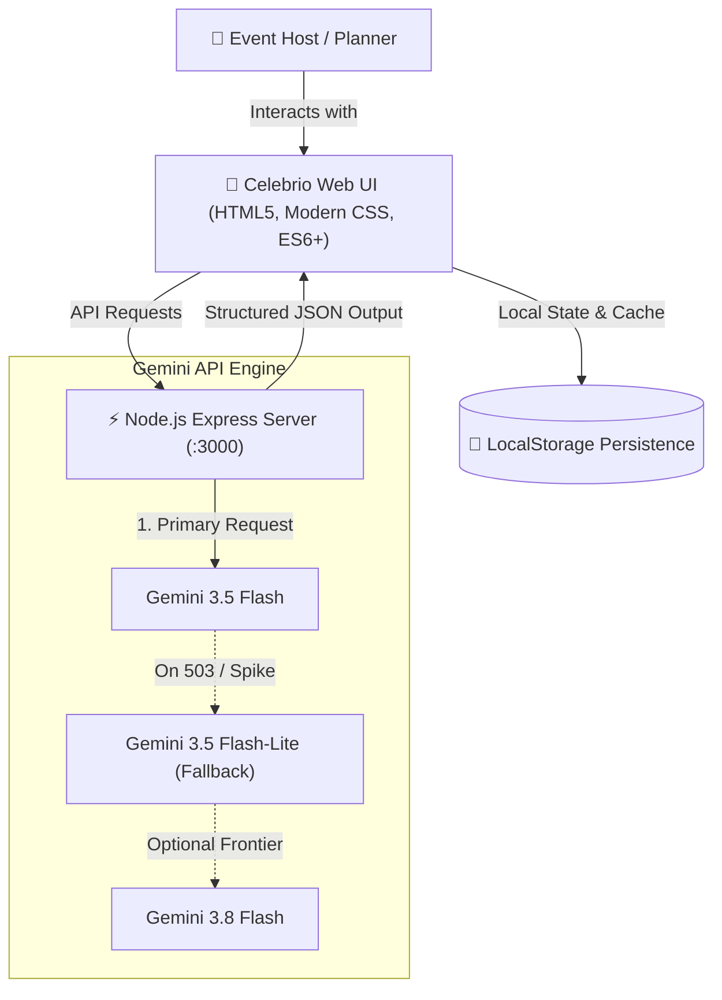

# ✨ Celebrio AI — Intelligent GenAI Celebration & Event Planner

> **Hackathon Challenge**: Celebration & Event Planner  
> **Mission Brief**: Create a GenAI-powered planning assistant that helps users organize **Weddings**, **Birthdays**, and **Community Events** with budgets, timelines, vendor checklists, and personalized ideas.  
> **Frontier AI Engine**: Google Gemini API (`gemini-3.5-flash`, `gemini-3.5-flash-lite`, `gemini-3.8-flash`) with automatic resilience cascading.

---

## 🌟 Overview & Key Highlights

**Celebrio AI** is a production-grade, end-to-end GenAI application designed to turn overwhelming event logistics into effortless, joyous celebration planning. Whether coordinating a 150-guest Tuscan vineyard wedding, a neon retro 80s synthwave milestone birthday, or a 350-attendee annual harvest charity gala, Celebrio AI acts as an executive event director in your pocket.

### 🏆 Core Capabilities

1. 🎨 **GenAI Theme & Moodboard Studio**:
   - Synthesizes bespoke aesthetic concepts with exact 5-color harmonized palettes (with 1-click Hex copying).
   - Generates signature cocktails & non-alcoholic mocktail recipes matching the celebration theme.
   - Provides decor highlights, sensory details, and musical atmosphere recommendations.

2. 💰 **Dynamic Budget Calculator & AI Optimizer**:
   - Intelligently distributes budgets across categories (Venue, Catering, Floral/Decor, Photography, Entertainment, Stationery, Attire/Favors, Contingency).
   - Multi-segment visual progress bar reflecting live spending vs allocated amounts.
   - **"🤖 AI Budget Optimizer"**: Analyzes active expenses and recommends high-impact cost-saving alternatives without compromising the guest experience.

3. ⏳ **Phased Milestones & Day-Of Run of Show**:
   - Phased countdown checklist (12-6 months out, 3-6 months, 1 month, 24 hours prior) with interactive progress tracking.
   - Master minute-by-minute **Run of Show** detailing cues, designated coordinator leads, locations, and execution notes.

4. 🤝 **Comprehensive Vendor Management Hub**:
   - Status tracking pipeline (`Researching` ➔ `Inquired / Contacted` ➔ `Contracted` ➔ `Paid in Full`).
   - Deliverables checklist and key questions for each vendor category.
   - **"✉️ AI Vendor RFP Generator"**: One-click generation of professional request-for-proposals and inquiries tailored to the event parameters and target budget.

5. 💡 **Creative Studio (Speeches, Invites & Activities)**:
   - **AI Speech & Toast Writer**: Tailors authentic, memorable toasts (Best Man, Maid of Honor, Host Welcome, Keynote) with custom tone controls and stage delivery cues (`[pause for laughter]`, `[raise glass]`).
   - **Invitation Suite Copywriter**: Generates headlines, poetic openings, RSVP guidelines, and dress-code tips.
   - **Signature Games & Activities**: Generates tailored party activities, icebreakers, and tournament setups with required supply lists.

6. 🤖 **Celebrio Co-Pilot (Contextual AI Assistant)**:
   - An always-on event planning partner loaded with the full context of your active celebration.
   - Quick chips for timeline conflict auditing, rain contingency planning, and vendor negotiation tips.

7. 🖨️ **Print & PDF Event Master Binder**:
   - Custom `@media print` stylesheet that exports the entire event dossier into a clean, professional PDF binder ready for coordinators and vendors on the day of the event.

---

## 🏗️ Architecture & Technology Stack



- **Frontend**: Responsive Single Page App, CSS Variables, Glassmorphism, Native `<dialog>` Modals, Popovers, Print Stylesheet.
- **Backend**: Node.js, Express, CORS, Dotenv.
- **AI Integration**: Google Gemini API via official HTTP REST endpoint (`v1beta`), model cascade resilience, structured JSON extraction.

---

## 🚀 Quick Start Guide

### 1. Prerequisites
- Node.js (v18+)
- Active Gemini API Key (configured in `.env` or entered directly into the in-app Settings modal)

### 2. Installation & Launch
```bash
cd celebrate-ai
npm install
node server.js
```

Open your browser at:
👉 **`http://localhost:3000`**

---

## 💎 Pre-Loaded Showcase Events
To experience the application immediately without typing a prompt, switch between three pre-built showcase events:
1. 💍 **Seraphina & Liam's Tuscan Vineyard Wedding** ($38,000 | 110 Guests | Sonoma, CA)
2. 🎂 **Leo's 30th Neon Synthwave Arcade Bash** ($5,500 | 50 Guests | Austin, TX)
3. 🌳 **Oakridge Harvest & Heritage Community Festival** ($22,000 | 350 Guests | Centennial Park)

Or click **"✨ New Event Wizard"** to watch Gemini generate an entire celebration from scratch in seconds!
