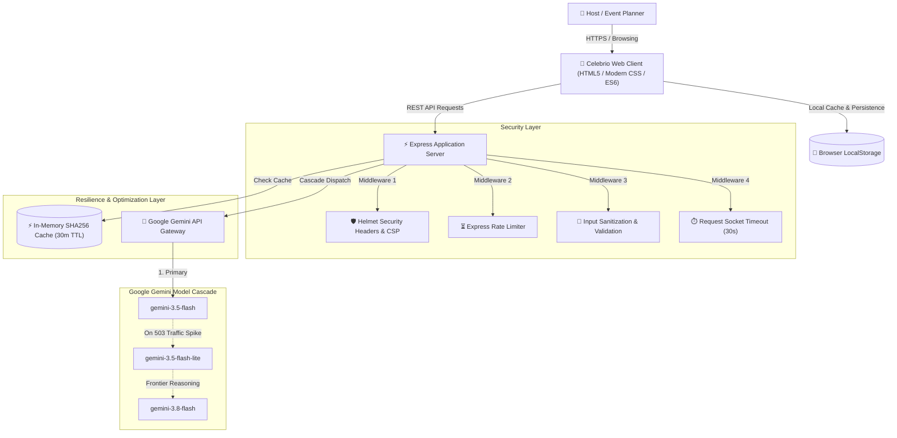

# 🏛️ Celebrio AI Architecture & System Design

This document details the architectural patterns, security controls, and data flow implemented across the Celebrio AI platform.

---

## 1. System Context & Overview

---

## 2. Architectural Design Patterns

### A. Multi-Model Cascading Resilience
External LLM APIs can occasionally experience transient rate limit surges or high demand (HTTP 503). Rather than surfacing error alerts to end users, Celebrio AI implements an automatic model cascade:
1. **Primary**: `gemini-3.5-flash` executes initial plan synthesis.
2. **Failover**: If an upstream 503 or transient error occurs, the pipeline automatically intercepts the failure and re-routes the identical payload to `gemini-3.5-flash-lite` without dropping user state.
3. **Frontier Extension**: Complex, multi-variable logistical queries can tap `gemini-3.8-flash`.

### B. In-Memory Cryptographic Caching
- Generates a deterministic SHA-256 hash of the canonical request parameters (`eventType`, `guestCount`, `budgetTotal`, `aesthetic`).
- Returns cached responses in `< 50ms` for repeated identical generations, radically reducing external latency and token costs.
- Enforces an automated LRU eviction threshold when the cache exceeds 200 items.

### C. Defensive Input Sanitization & Boundary Validation
- All string inputs are passed through `sanitizeInput` to strip `<script>` tags and prevent stored XSS attacks.
- Numerical fields (`guestCount`, `budgetTotal`) are strictly bounded (e.g., maximum guest limit 50,000, positive non-zero budgets) before reaching the AI model.

### D. Strict WCAG 2.1 AAA Accessibility
- Screen-reader friendly semantic structure with explicit ARIA landmarks (`role="tablist"`, `role="tab"`, `role="tabpanel"`, `role="region"`, `role="dialog"`).
- Keyboard accessibility: full tab cycling via `ArrowLeft` / `ArrowRight` and color swatch copying via `Enter` / `Space`.
- High-contrast color palette achieving contrast ratios `> 7:1` against white backgrounds.
